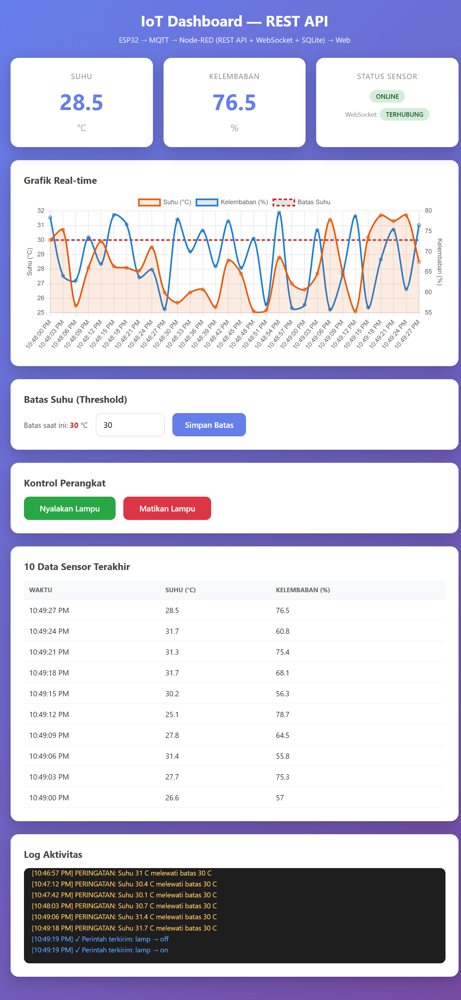

Nama : Maya Ardila Riani
NPM : 2410020050

# IoT REST API dengan Node-RED

Praktikum **REST API Node-RED untuk IoT**: simulator ESP32 mengirim data sensor lewat MQTT,
Node-RED menyediakan REST API, WebSocket, dan database SQLite, lalu data ditampilkan di dashboard web.

```
Simulator ESP32 (Python) --MQTT--> Mosquitto --MQTT--> Node-RED --REST / WebSocket--> Dashboard Web
                                                          |
                                                       SQLite
```

## Isi repo

| File | Keterangan |
|---|---|
| `simulasi_esp32.py` | Simulator ESP32 (publish suhu & kelembaban, subscribe perintah kontrol) |
| `flows/flow_api_dasar.json` | Flow modul dasar (GET suhu, GET history, POST kontrol, CORS) |
| `flows/flow_api_lengkap.json` | Flow lengkap + 5 tugas pengembangan |
| `dashboard/dashboard.html` | Dashboard web (Chart.js, WebSocket, API key, threshold) |
| `docs/dashboard.png` | Screenshot hasil dashboard |

## Tugas pengembangan

| No | Tugas | Implementasi |
|---|---|---|
| 1 | Endpoint `PUT /api/threshold` + notifikasi | Batas suhu disimpan di flow context (default 30 °C). Jika suhu melewati batas, Node-RED mengirim peringatan ke debug, topic MQTT `iot/alert`, dan banner di dashboard (maks. 1x per 10 detik). Ada juga `GET /api/threshold`. |
| 2 | Grafik real-time Chart.js | Grafik suhu, kelembaban, dan garis batas suhu di dashboard. |
| 3 | API key `X-API-Key` | Semua endpoint `/api/*` (kecuali preflight `OPTIONS`) mengembalikan **401** bila header salah atau tidak ada. |
| 4 | WebSocket | Node-RED mengirim data ke `ws://localhost:1880/ws/sensor`, dashboard tanpa polling (polling hanya cadangan saat WebSocket putus). |
| 5 | History ke SQLite | Tiap data sensor disimpan ke tabel `sensor_log`; `GET /api/history` membaca 50 data terakhir dari database. |

## Cara menjalankan

### 1. Persiapan
- Node.js, Node-RED (`npm install -g --unsafe-perm node-red`), Python 3, Mosquitto
- `python -m pip install paho-mqtt`
- Di folder `~/.node-red` (Windows: `C:\Users\NAMA\.node-red`): `npm install node-red-node-sqlite`
- Buat folder `C:\iot-praktikum\` (lokasi file database). Di Linux/Mac ubah path di node konfigurasi SQLite.

### 2. Urutan menjalankan
1. `mosquitto -v`
2. `node-red`, buka `http://localhost:1880`, menu ☰ → **Import** → pilih `flows/flow_api_lengkap.json` → **Deploy**
3. `python simulasi_esp32.py`
4. Buka dashboard. Cara paling aman (tanpa masalah CORS): set `httpStatic` di `settings.js` Node-RED ke folder `dashboard/`, restart Node-RED, buka `http://localhost:1880/dashboard.html`.

API key default: `iot-api-key-2026` (ubah di node **Cek API Key + Route** dan di `dashboard.html`, atau set environment variable `IOT_API_KEY`).

## Endpoint

Semua request memakai header `X-API-Key: iot-api-key-2026`.

| Method | URL | Fungsi |
|---|---|---|
| GET | `/api/suhu` | Data sensor terakhir |
| GET | `/api/history` | 50 data terakhir dari SQLite |
| POST | `/api/kontrol` | Kirim perintah, body `{"device":"lamp","action":"on"}` |
| GET | `/api/threshold` | Lihat batas suhu |
| PUT | `/api/threshold` | Set batas suhu, body `{"max": 30}` |

### Contoh (curl)
```
curl -H "X-API-Key: iot-api-key-2026" http://localhost:1880/api/suhu
curl -X PUT -H "X-API-Key: iot-api-key-2026" -H "Content-Type: application/json" -d "{\"max\":28}" http://localhost:1880/api/threshold
curl http://localhost:1880/api/suhu        # tanpa key -> 401
```

## Hasil pengujian

Diuji end-to-end (broker MQTT, Node-RED, SQLite, browser):
- Tanpa / salah API key → 401; dengan key benar → 200
- `PUT /api/threshold` valid → 200, body kosong → 400
- `POST /api/kontrol` valid → 200 dan pesan sampai ke `iot/kontrol`; body kosong → 400
- Preflight `OPTIONS` → 204 dengan header CORS
- Suhu melewati batas → pesan di `iot/alert` dan banner dashboard
- WebSocket mengirim data tiap pesan sensor; data tersimpan di SQLite



## Troubleshooting

| Masalah | Solusi |
|---|---|
| Error CORS pada tombol kontrol | Pakai flow `flow_api_lengkap.json`, klik **Deploy**, atau buka dashboard lewat `http://localhost:1880/dashboard.html` |
| Node `sqlite` tidak ada | Pasang `node-red-node-sqlite` lewat Manage Palette, restart Node-RED |
| `TypeError` pada `mqtt.Client` | Gunakan `mqtt.CallbackAPIVersion.VERSION2` (sudah dipakai di repo ini) |
